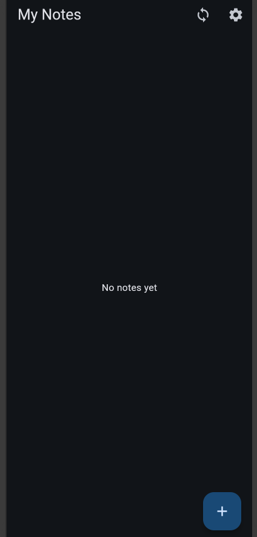
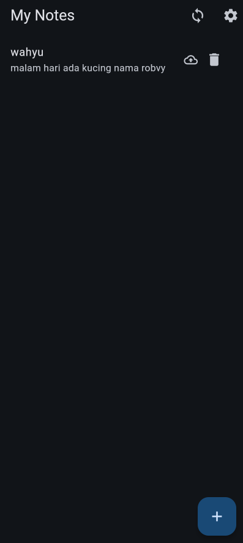
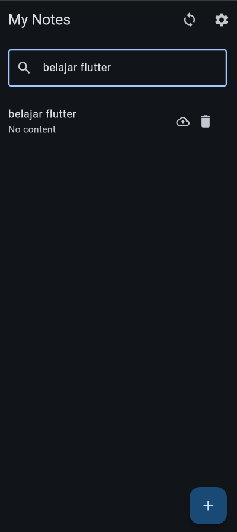

# Week 9 — AI-Assisted Development & Vibe Coding

## Identitas

Nama: Wahyu Fairuz Daniswara  
NIM: 244107020225  
Program Studi: D4 Teknik Informatika  
Institusi: Politeknik Negeri Malang

## Deskripsi

Pada Week 9, praktikum membahas penggunaan Artificial Intelligence (AI) dalam proses pengembangan aplikasi Flutter melalui pendekatan AI-Assisted Development dan Vibe Coding.

Aplikasi yang dikembangkan adalah **Offline Notes**, aplikasi pencatatan sederhana berbasis SQLite yang dikembangkan dengan bantuan AI untuk menambahkan fitur pencarian notes serta melakukan code review dan testing.

## Teknologi

- Flutter & Dart
- Riverpod
- SQLite / sqflite
- SharedPreferences
- sqflite_common_ffi
- Flutter Test
- AI-Assisted Development

## Fitur

- Menampilkan daftar notes
- Menambahkan notes
- Menghapus notes
- Menyimpan notes ke SQLite
- Menyimpan pengaturan theme
- Light mode dan dark mode
- Dirty state untuk data yang belum tersinkronisasi
- Sinkronisasi data lokal
- Pencarian notes berdasarkan title
- Search case-insensitive
- Empty state ketika tidak ada hasil pencarian
- Automated testing untuk fitur Search

## Implementasi

### 1. AI-Assisted Development

AI digunakan untuk membantu proses pengembangan fitur Search, memberikan usulan implementasi, serta melakukan code review terhadap kode yang dihasilkan.

Prompt disusun menggunakan pendekatan Context Engineering dan Five-Slot Prompt untuk memberikan konteks, tugas, batasan, dan output yang diharapkan.

### 2. Search Notes

Fitur Search ditambahkan pada `NotesPage` menggunakan TextField.

Pencarian dilakukan berdasarkan title notes dengan:
- Case-insensitive matching
- Dynamic filtering ketika pengguna mengetik
- Empty state ketika tidak ditemukan notes yang sesuai
- Filter dilakukan pada data notes yang telah dimuat dari SQLite melalui Riverpod

### 3. AI Code Review

AI melakukan review terhadap implementasi Search dengan fokus pada:
- Correctness
- Architecture
- Testing

Hasil review dievaluasi secara kritis. Tidak semua rekomendasi AI diterapkan karena keputusan perubahan kode tetap mempertimbangkan kebutuhan aplikasi dan kesederhanaan implementasi.

### 4. AI Challenge

AI Challenge dilakukan dengan memverifikasi hasil code review dan menilai rekomendasi AI secara kritis.

- Search filtering menggunakan data in-memory telah diverifikasi.
- Search state lokal pada `NotesPage` dipertahankan karena sesuai dengan kebutuhan fitur.
- Automated tests ditambahkan untuk memverifikasi case-insensitive search dan empty results.

### 5. Testing

Testing dilakukan menggunakan Flutter Test untuk memastikan fungsi pencarian berjalan sesuai kebutuhan.

Perintah menjalankan test:

```bash
flutter test test/widget_test.dart
```

Hasil testing: **All tests passed.**

Analisis kode dilakukan menggunakan:

```bash
flutter analyze
```

Hasil analisis: **No issues found.**

## AI Development Log

Dokumentasi proses AI-assisted development tersedia pada:

`docs/ai-log.md`

Dokumentasi mencakup:
- Prompt Engineering
- Context Engineering
- AI-generated implementation
- Verification
- Accept/Reject Decisions
- AI Code Review
- AI Challenge Evidence

## Screenshots

### My Notes



### Add Notes



### Search Notes


## Kesimpulan

Pada praktikum Week 9 berhasil diterapkan pendekatan AI-Assisted Development dalam pengembangan aplikasi Flutter. Fitur Search berhasil ditambahkan dan diuji menggunakan Flutter Test.

Selain menghasilkan kode, proses pengembangan juga melibatkan evaluasi hasil AI, code review, verifikasi implementasi, serta pengambilan keputusan terhadap rekomendasi AI berdasarkan kebutuhan aplikasi.
