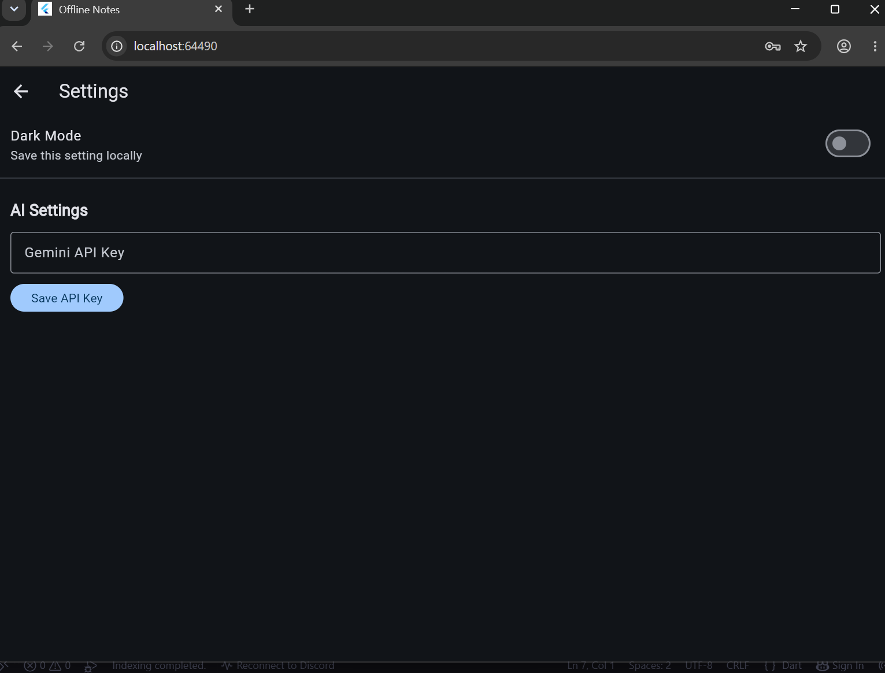
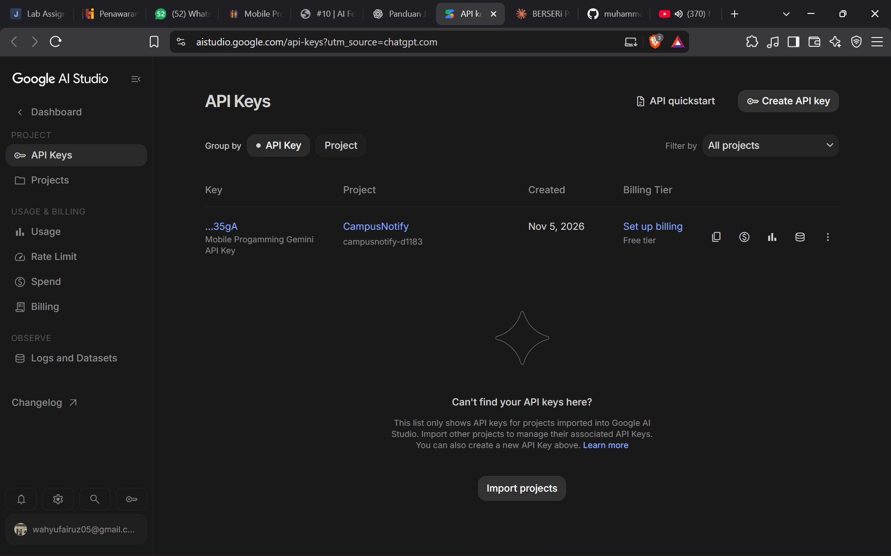
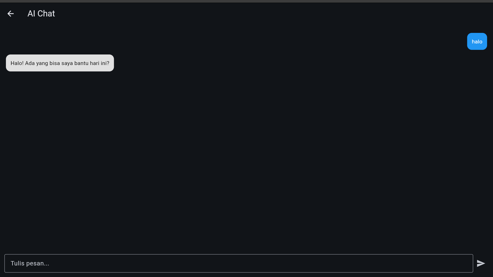

# Week 10 - AI Feature Integration

## Project Information

- **Name:** Wahyu Fairuz Daniswara
- **NIM:** 244107020225
- **Class:** TI-2I
- **Course:** Mobile Programming
- **Project:** Offline Notes AI Integration

## Overview

This project is an Offline Notes application enhanced with an AI Chat feature using Google Gemini API. The integration allows users to interact with an AI assistant directly from the application.

## AI Features

- AI Chat interface
- Send messages to Google Gemini
- Display AI responses in chat bubbles
- Loading indicator while waiting for AI responses
- Error handling when AI service is unavailable
- API key configuration through application settings
- Secure API key storage using Flutter Secure Storage

## Technologies Used

- Flutter
- Dart
- Riverpod
- SQLite
- Google Gemini API
- HTTP
- Flutter Secure Storage

## AI Integration

The application communicates with Google Gemini API using HTTP requests.

The API key is stored using Flutter Secure Storage and is not hardcoded into the source code.

### AI Workflow

1. User opens AI Chat from the Notes page.
2. User enters a message.
3. The application retrieves the API key from secure storage.
4. The application sends the message to Google Gemini API.
5. Gemini generates a response.
6. The response is displayed in the AI Chat interface.

## Risk and Mitigation

| Risk | Mitigation |
|---|---|
| API key exposure | Store API key using Flutter Secure Storage |
| Sensitive information sent to AI | Avoid sending personal or confidential information |
| AI service unavailable | Display an error message when requests fail |
| Excessive API requests | Avoid unnecessary API calls |
| Network failure | Handle API exceptions gracefully |

## Screenshots

### AI Settings



### API Key Configuration



### AI Chat



## Testing

## Testing

### Flutter Analyze
```text
No issues found!
```

### Flutter Test
```text
All tests passed!
```

## Reflection

Through this project, I learned how to integrate an external AI service into a Flutter application.

I implemented an AI Chat interface, configured Google Gemini API communication, and stored API keys securely using Flutter Secure Storage.

I also learned how to handle API errors and display responses from an AI service in the application.
