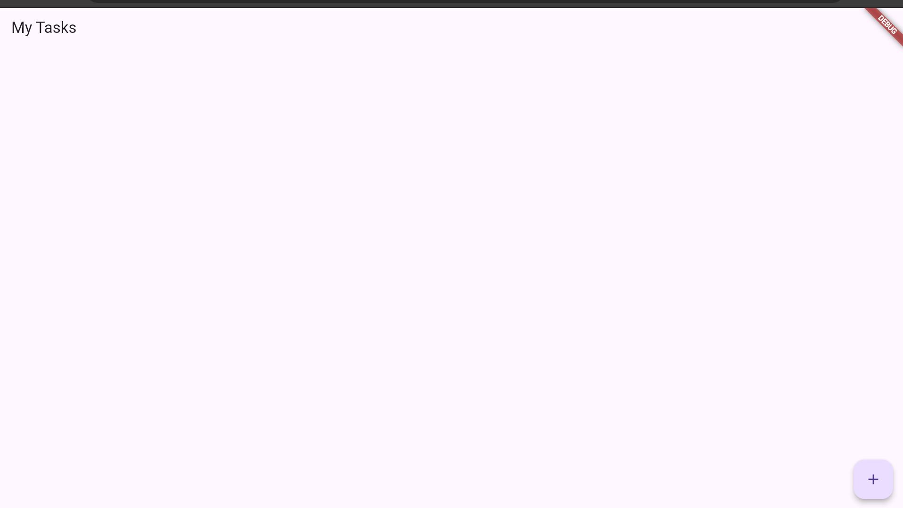

# Week 12 – Testing and Quality Assurance

## Identitas

| Informasi | Detail |
|---|---|
| Nama | Wahyu Fairuz Daniswara |
| NIM | 244107020225 |
| Kelas | TI-2I |
| Program Studi | D4 Teknik Informatika |
| Jurusan | Teknologi Informasi |
| Institusi | Politeknik Negeri Malang |
| Mata Kuliah | Mobile Programming |

---

## Deskripsi Praktikum

Praktikum Week 12 membahas **Testing and Quality Assurance** pada pengembangan aplikasi Flutter.

Pada praktikum ini dibuat aplikasi sederhana bernama **My Tasks** untuk menerapkan pengujian perangkat lunak menggunakan Flutter Test. Pengujian dilakukan pada repository dan widget aplikasi untuk memastikan fungsi berjalan sesuai dengan yang diharapkan.

## Tujuan

- Memahami konsep testing pada aplikasi Flutter.
- Menerapkan unit testing pada repository.
- Menerapkan widget testing pada tampilan aplikasi.
- Memastikan fungsi penambahan task berjalan dengan benar.
- Memeriksa kualitas kode menggunakan Flutter Analyze.

## Implementasi

### 1. Task Model

File: `lib/task.dart`

Model `Task` digunakan untuk merepresentasikan data task dengan atribut:

- `title`: judul task.
- `isCompleted`: status penyelesaian task, dengan nilai awal `false`.

### 2. Task Repository

File: `lib/task_repository.dart`

Repository dibuat menggunakan abstract class `TaskRepository` yang menyediakan method:

- `getTasks()`: mengambil daftar task.
- `addTask(Task task)`: menambahkan task baru.

### 3. Fake Task Repository

File: `lib/fake_task_repository.dart`

`FakeTaskRepository` merupakan implementasi repository sederhana yang menyimpan task di dalam list lokal.

Implementasi ini digunakan untuk mendukung proses testing tanpa membutuhkan database atau backend.

### 4. My Tasks Application

File: `lib/main.dart`

Aplikasi My Tasks memiliki fitur:

- Menampilkan halaman My Tasks.
- Menampilkan daftar task.
- Menambahkan task melalui dialog.
- Memasukkan judul task menggunakan TextField.
- Menampilkan task yang berhasil ditambahkan.

## Testing

Pengujian dilakukan menggunakan Flutter Test.

### Repository Testing

File: `test/task_repository_test.dart`

Pengujian repository meliputi:

1. Memastikan repository memiliki daftar task kosong pada awalnya.
2. Memastikan task berhasil ditambahkan ke repository.
3. Memastikan beberapa task dapat ditambahkan ke repository.

### Widget Testing

File: `test/task_page_test.dart`

Pengujian widget meliputi:

1. Memastikan halaman My Tasks berhasil ditampilkan.
2. Memastikan task dapat ditambahkan melalui UI aplikasi.

## Hasil Pengujian

| Pengujian | Hasil |
|---|---|
| Repository Test | Passed |
| Widget Test | Passed |
| Total Test | 5 Passed |
| Flutter Analyze | No issues found |
| Flutter Test Coverage | Berhasil dibuat |

## Screenshot Aplikasi

Berikut merupakan screenshot aplikasi My Tasks setelah dijalankan.



## Struktur Project

```text
testing_lab/
├── docs/
│   └── image/
│       └── MyTask.png
├── lib/
│   ├── fake_task_repository.dart
│   ├── main.dart
│   ├── task.dart
│   └── task_repository.dart
├── test/
│   ├── task_page_test.dart
│   └── task_repository_test.dart
├── coverage/
│   └── lcov.info
├── pubspec.yaml
└── README.md
```

## Menjalankan Aplikasi

Pastikan Flutter sudah terinstall pada perangkat.

```bash
flutter pub get
flutter run
```

## Menjalankan Testing

Untuk menjalankan seluruh test:

```bash
flutter test
```

Untuk menjalankan test dengan coverage:

```bash
flutter test --coverage
```

Untuk memeriksa kualitas kode:

```bash
flutter analyze
```

## Kesimpulan

Pada praktikum Week 12, telah dibuat aplikasi My Tasks menggunakan Flutter dengan penerapan unit testing dan widget testing.

Pengujian dilakukan pada repository dan tampilan aplikasi. Seluruh 5 test berhasil dijalankan, serta Flutter Analyze menunjukkan tidak ditemukan masalah pada kode.

Dengan praktikum ini, testing dapat digunakan untuk membantu memastikan aplikasi berjalan sesuai dengan fungsi yang diharapkan dan meningkatkan kualitas kode.